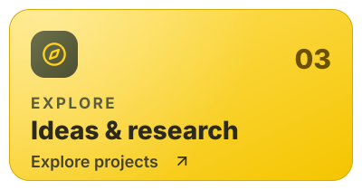

<h2 align="center">The Work</h2>

  
  
  

<h2 align="center">GitHub Activity</h2>

  
    
  

<h2 align="center">Selected Projects</h2>

<!-- projects:start -->

<a href="https://github.com/hitenborkar1406-ops/SMART_TRAFFIC_MANAGEMENT_SYSTEM"><b>Smart Traffic Management</b></a>&nbsp;&nbsp;★ 1 &nbsp;·&nbsp; Forks 0 &nbsp;·&nbsp; Updated Nov 2026 
Predictive congestion and alternate routing for Nagpur. 
<code>React</code> <code>FastAPI</code> <code>XGBoost</code> <code>Leaflet</code>

<a href="https://github.com/hitenborkar1406-ops/IPL_CRUNCH"><b>IPL Crunch ’26</b></a>&nbsp;&nbsp;★ 1 &nbsp;·&nbsp; Forks 0 &nbsp;·&nbsp; Updated Nov 2026 
Ball-by-ball IPL analytics from raw Cricsheet JSON. 
<code>Python</code> <code>Pandas</code> <code>Plotly</code> <code>SciPy</code>

<a href="https://github.com/hitenborkar1406-ops/PROMPTWARS"><b>The Blind Spot</b></a>&nbsp;&nbsp;★ 1 &nbsp;·&nbsp; Forks 0 &nbsp;·&nbsp; Updated Nov 2026 
AI-assisted analysis of assumptions and decision biases. 
<code>JavaScript</code> <code>HTML</code> <code>CSS</code>

<a href="https://github.com/hitenborkar1406-ops/VEHICLE-RENTAL-SYSTEM"><b>Vehicle Rental System</b></a>&nbsp;&nbsp;★ 1 &nbsp;·&nbsp; Forks 0 &nbsp;·&nbsp; Updated Nov 2026 
Flask app with booking rules and automated tests. 
<code>Python</code> <code>Flask</code> <code>SQLite</code> <code>pytest</code>

<!-- projects:end -->

<h2 align="center">Code Distribution</h2>

  

<h2 align="center">Technical Skills</h2>

<!-- skills:start -->

<b>Languages</b> 
&nbsp;C &nbsp;·&nbsp; &nbsp;C++ &nbsp;·&nbsp; &nbsp;Python &nbsp;·&nbsp; &nbsp;Java &nbsp;·&nbsp; &nbsp;JavaScript &nbsp;·&nbsp; &nbsp;SQL

<b>Web Development</b> 
&nbsp;HTML5 &nbsp;·&nbsp; &nbsp;CSS3

<b>ML &amp; Data</b> 
&nbsp;Pandas &nbsp;·&nbsp; &nbsp;NumPy &nbsp;·&nbsp; &nbsp;Matplotlib

<b>CS Fundamentals</b> 
&nbsp;DSA &nbsp;·&nbsp; &nbsp;OOP &nbsp;·&nbsp; &nbsp;DBMS &nbsp;·&nbsp; &nbsp;Operating Systems &nbsp;·&nbsp; &nbsp;Computer Networks

<b>Design &amp; Tools</b> 
&nbsp;UML &nbsp;·&nbsp; &nbsp;OOD &nbsp;·&nbsp; &nbsp;GoF Design Patterns &nbsp;·&nbsp; &nbsp;Git &nbsp;·&nbsp; &nbsp;GitHub &nbsp;·&nbsp; &nbsp;Linux &nbsp;·&nbsp; &nbsp;VS Code

<b>Cloud · Google Cloud</b> 
&nbsp;Google Cloud &nbsp;·&nbsp; &nbsp;Compute Engine &nbsp;·&nbsp; &nbsp;Cloud Storage &nbsp;·&nbsp; &nbsp;VPC &nbsp;·&nbsp; &nbsp;Cloud Shell

<!-- skills:end -->

 

Designed with intent. Built with curiosity. Refreshed daily by GitHub Actions.

