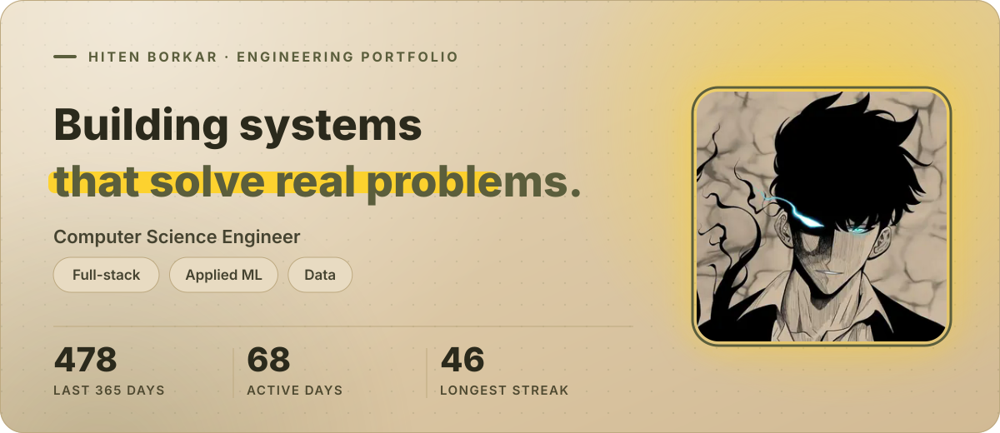
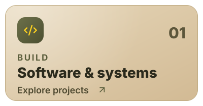
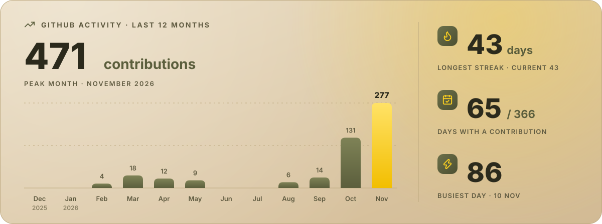
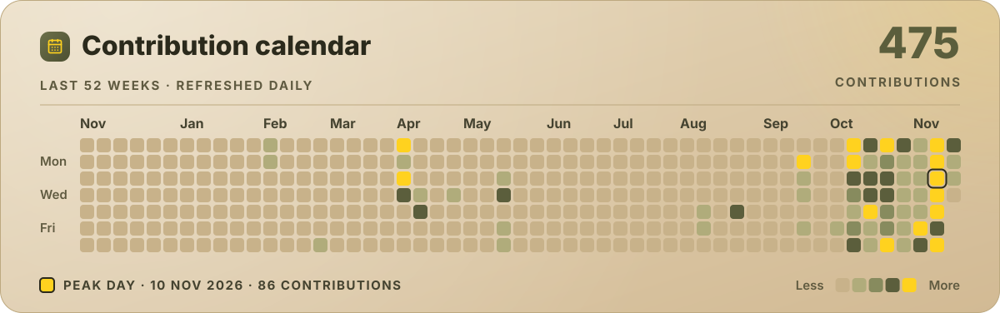
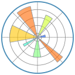

<h2 align="center">The Work</h2>

  
  
  

<h2 align="center">GitHub Activity</h2>

  
    
  

<h2 align="center">Selected Projects</h2>

<!-- projects:start -->
<table>
<tr>
<td width="50%" valign="top">
<h3><a href="https://github.com/hitenborkar1406-ops/SMART_TRAFFIC_MANAGEMENT_SYSTEM">Smart Traffic Management</a></h3>

Predictive congestion and alternate routing for Nagpur.

<code>React</code> <code>FastAPI</code> <code>XGBoost</code> <code>Leaflet</code>

★ 1 &nbsp;·&nbsp; Forks 0 &nbsp;·&nbsp; Updated Nov 2026
</td>
<td width="50%" valign="top">
<h3><a href="https://github.com/hitenborkar1406-ops/IPL_CRUNCH">IPL Crunch ’26</a></h3>

Ball-by-ball IPL analytics from raw Cricsheet JSON.

<code>Python</code> <code>Pandas</code> <code>Plotly</code> <code>SciPy</code>

★ 1 &nbsp;·&nbsp; Forks 0 &nbsp;·&nbsp; Updated Nov 2026
</td>
</tr>
<tr>
<td width="50%" valign="top">
<h3><a href="https://github.com/hitenborkar1406-ops/PROMPTWARS">The Blind Spot</a></h3>

AI-assisted analysis of assumptions and decision biases.

<code>JavaScript</code> <code>HTML</code> <code>CSS</code>

★ 1 &nbsp;·&nbsp; Forks 0 &nbsp;·&nbsp; Updated Nov 2026
</td>
<td width="50%" valign="top">
<h3><a href="https://github.com/hitenborkar1406-ops/VEHICLE-RENTAL-SYSTEM">Vehicle Rental System</a></h3>

Flask app with booking rules and automated tests.

<code>Python</code> <code>Flask</code> <code>SQLite</code> <code>pytest</code>

★ 1 &nbsp;·&nbsp; Forks 0 &nbsp;·&nbsp; Updated Nov 2026
</td>
</tr>
</table>
<!-- projects:end -->

<h2 align="center">Code Distribution</h2>

  

<h2 align="center">Technical Skills</h2>

<!-- skills:start -->
<table>
<tr>
<th align="left" valign="top" width="190">Languages</th>
<td>&nbsp;C &nbsp;·&nbsp; &nbsp;C++ &nbsp;·&nbsp; &nbsp;Python &nbsp;·&nbsp; &nbsp;Java &nbsp;·&nbsp; &nbsp;JavaScript &nbsp;·&nbsp; &nbsp;SQL</td>
</tr>
<tr>
<th align="left" valign="top" width="190">Web Development</th>
<td>&nbsp;HTML5 &nbsp;·&nbsp; &nbsp;CSS3</td>
</tr>
<tr>
<th align="left" valign="top" width="190">ML &amp; Data</th>
<td>&nbsp;Pandas &nbsp;·&nbsp; &nbsp;NumPy &nbsp;·&nbsp; &nbsp;Matplotlib</td>
</tr>
<tr>
<th align="left" valign="top" width="190">CS Fundamentals</th>
<td>&nbsp;DSA &nbsp;·&nbsp; &nbsp;OOP &nbsp;·&nbsp; &nbsp;DBMS &nbsp;·&nbsp; &nbsp;Operating Systems &nbsp;·&nbsp; &nbsp;Computer Networks</td>
</tr>
<tr>
<th align="left" valign="top" width="190">Design &amp; Tools</th>
<td>&nbsp;UML &nbsp;·&nbsp; &nbsp;OOD &nbsp;·&nbsp; &nbsp;GoF Design Patterns &nbsp;·&nbsp; &nbsp;Git &nbsp;·&nbsp; &nbsp;GitHub &nbsp;·&nbsp; &nbsp;Linux &nbsp;·&nbsp; &nbsp;VS Code</td>
</tr>
<tr>
<th align="left" valign="top" width="190">Cloud · Google Cloud</th>
<td>&nbsp;Google Cloud &nbsp;·&nbsp; &nbsp;Compute Engine &nbsp;·&nbsp; &nbsp;Cloud Storage &nbsp;·&nbsp; &nbsp;VPC &nbsp;·&nbsp; &nbsp;Cloud Shell</td>
</tr>
</table>
<!-- skills:end -->

 

Designed with intent. Built with curiosity. Refreshed daily by GitHub Actions.

