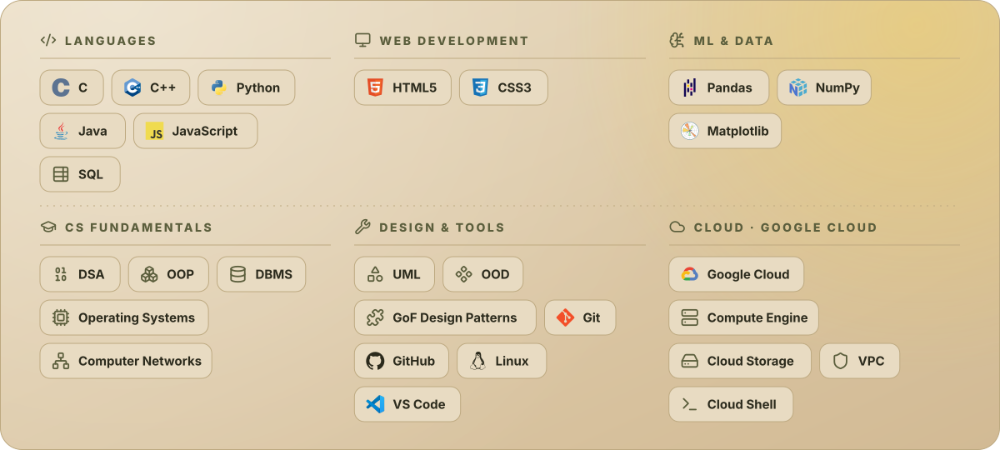

<h2 align="center">The Work</h2>

  
  
  

<h2 align="center">GitHub Activity</h2>

  
    
  

<h2 align="center">Selected Projects</h2>

  
  
  
  

<h2 align="center">Code Distribution</h2>

  

<h2 align="center">Technical Skills</h2>

  

 

Designed with intent. Built with curiosity. Refreshed daily by GitHub Actions.

